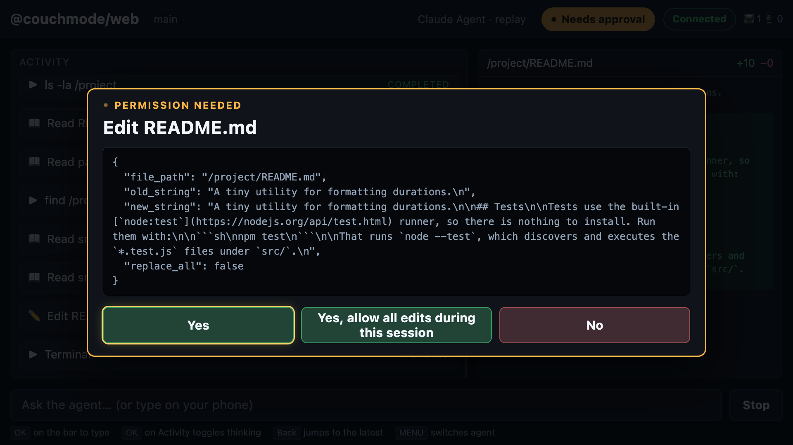

# Couchmode

[](https://github.com/maximbilan/couchmode/actions/workflows/ci.yml)
[](LICENSE)

**Your coding agent, in couch mode.** The [Agent Client Protocol](https://agentclientprotocol.com)
client for the living room.

Zed and JetBrains are ACP clients for the desk. Couchmode is the one for the
couch: your agent runs on your laptop against a real project, a Fire TV shows
what it is doing in large readable form, and you approve or reject its tool
calls with the remote.



## Why this exists

Coding agents spend a lot of their time waiting for a human to say yes. That
moment does not need a keyboard, a terminal, or even a desk. It needs a big
clear description of what is about to happen and two buttons. That is a TV.

Couchmode does not invent a protocol. It implements ACP and documents how each
concept maps to a 10-foot UI — see [`docs/acp-on-tv.md`](docs/acp-on-tv.md).

## Run in 60 seconds

No TV needed — your phone or a second browser tab is enough. Requires
**Node 22+** (the Claude adapter requires it) and `pnpm`.

```sh
git clone https://github.com/maximbilan/couchmode && cd couchmode
pnpm install && pnpm build

cd ~/some/project
node /path/to/couchmode/packages/bridge/dist/cli.js --agent claude
```

The terminal prints a 6-digit pair code and a LAN URL. Open
`http://<your-ip>:7777/phone` on your phone, type the code, and ask the agent
for something. When it wants to edit a file or run a command, the approval
lands on your phone.

### Try it without spending tokens

Couchmode ships a recording of a real Claude session and can replay it as a
live ACP agent:

```sh
node packages/bridge/dist/cli.js --fake
```

The replay includes two permission requests and a file diff, and blocks until
you actually submit a prompt — the bridge's ACP code path is identical to a
live run.

Open `http://localhost:7777/tv` in a browser at 1920×1080 to drive the 10-foot
UI with the arrow keys, Enter and Escape — exactly the buttons a Fire TV remote
has. Nothing in `/tv` needs a pointer.

## The TV UI

`/tv` is designed for 1920×1080 viewed from about three metres: body text 28px,
controls at least 64px tall, and a bright 3px focus ring. Focus moves
spatially — there is no tab order, because a remote has no Tab key.

| Button  | What it does                                                                                   |
| ------- | ---------------------------------------------------------------------------------------------- |
| ▲ ▼ ◀ ▶ | move focus, or scroll the panel you are in — a page at a time, faster while held               |
| OK      | activate; on the prompt bar it opens a text field; on Activity it expands the agent's thinking |
| Back    | close what is open, answer a permission request with its deny option, or jump to the latest    |
| MENU    | switch agents (long press opens the Fire TV shell's own settings form)                         |

- **Permission requests take over the screen.** A modal takes focus and shows
  the agent's own options in the order it gave them. See
  [which button the remote starts on](docs/acp-on-tv.md#which-button-the-remote-starts-on),
  and why.
- **Long conversations stay escapable.** A press moves most of a page, holding
  the button accelerates, and **Back always returns to the present** — the
  prompt bar is never more than two presses away, however long the transcript.
- **The connection is stated in words** — **Connected**, **Reconnecting…**,
  **Disconnected · retrying in 4s** — because at three metres a small green dot
  and a small grey one are the same dot. Reconnecting rebuilds the transcript
  rather than duplicating it.
- **Switching agents happens on the TV.** Focus the agent's name or press
  **MENU**. The picker names the command each agent would actually run, and
  warns that switching ends the session before you choose.
- **The Changes panel** only appears once the agent has actually changed a
  file. Until then the activity feed has the whole screen.

The reasoning behind each of these is in
[ACP on a TV](docs/acp-on-tv.md#the-10-foot-layout).

## Fire TV setup

Verified on a Fire TV Stick running **Fire OS 8.1.8.2** (Android 11, API 30).

Enable ADB debugging on the device — _Settings → My Fire TV → Developer
Options → ADB debugging_ — then:

```sh
TV_IP=192.168.1.35 scripts/install-tv.sh
```

The TV asks for the address and pair code the bridge printed, remembers them,
and goes straight to `/tv` on every launch after that. Press and hold **MENU**
to change them.

The shell is deliberately thin: a fullscreen WebView and a settings form, with
no dependencies at all. Everything you see on screen is the web client the
bridge serves, so improving the TV experience means editing TypeScript, not
reinstalling an APK.

Two Fire OS behaviours worth knowing as a user:

- **Back** closes whatever is open — the composer, or a permission request
  (answering it with its deny option) — then catches the feed up to the latest
  activity. It only leaves the app when there is nothing left to do.
- While the on-screen keyboard is up, **Back is how you send a prompt**. Fire OS
  commits the text when the keyboard closes. There is also a Send button.

If the bridge is not running when the app starts, the shell says which problem
it is — your computer is there but the bridge isn't running, or the TV can't
find your computer at all — and keeps checking every two seconds. The page
appears by itself shortly after the bridge starts. Reopening a laptop lid in
another room is enough; nothing needs pressing on the TV.

The full friction log, including the bugs real hardware shook out, is in
[`docs/firetv-notes.md`](docs/firetv-notes.md).

## How it works

```
 ┌─────────────── your machine ───────────────┐            ┌─── Fire TV ────┐
 │                                            │◄──────────►│  WebView /tv   │
 │  agent CLI  ◄─stdio─►  couchmode bridge    │  WebSocket └────────────────┘
 │  (claude,   JSON-RPC   (the ACP client)    │   on LAN   ┌──── phone ─────┐
 │   codex, …)                                │◄──────────►│  browser       │
 │                                            │            │  /phone        │
 └────────────────────────────────────────────┘            └────────────────┘
```

The bridge is the ACP client. It owns the session, answers the agent's
filesystem and permission requests, and forwards every `session/update` to the
TV and phone unchanged. The TV and phone never talk to the agent — only the
machine holding your code can spawn processes and touch files.

Permission requests go to every paired client at once; the first answer wins.

## Supported agents

Agent launch is data, not code: see
[`packages/bridge/src/config/agents.json`](packages/bridge/src/config/agents.json),
overridable at `~/.couchmode/agents.json`.

| Agent  | Command                                        | Status                                |
| ------ | ---------------------------------------------- | ------------------------------------- |
| Claude | `npx -y @agentclientprotocol/claude-agent-acp` | ✅ tested — recorded fixture included |
| Kiro   | `kiro-cli acp`                                 | ✅ tested on Kiro CLI 2.21.4          |
| Codex  | `npx -y @agentclientprotocol/codex-acp`        | ⚪ untested                           |
| Gemini | `gemini --acp --skip-trust`                    | ⚪ untested                           |

Codex and Gemini are configured but have not been run yet.

Running an agent on Amazon Bedrock needs nothing from Couchmode: configure it in
the agent itself, and the agent Couchmode spawns inherits it.

- **Claude Code** — `CLAUDE_CODE_USE_BEDROCK=1` (or `CLAUDE_CODE_USE_VERTEX=1`
  for Google Vertex AI) in your environment or in the `env` block of
  `~/.claude/settings.json`.
- **Codex** — `model_provider = "amazon-bedrock"` in `~/.codex/config.toml`
  ([setup](https://learn.chatgpt.com/docs/config-file/config-advanced#amazon-bedrock-provider)).
  This runs OpenAI's models on Bedrock, not Claude, and has not been run
  through Couchmode yet.

Kiro can be billed to an AWS account, but it is a Kiro subscription rather than
your own Bedrock access. Gemini CLI has no Bedrock provider.

If an agent sits on "Thinking" forever, check that its cloud credentials have
not expired; see [`docs/upstream-issues.md`](docs/upstream-issues.md).

## Authentication

Couchmode doesn't handle credentials. It runs your agent's CLI, which uses the
login you already have. If a CLI isn't logged in, log in with that CLI first.

Couchmode never asks for, stores, displays, or forwards credentials. It passes
your ambient environment to the agent process and nothing auth-related ever
reaches the TV or phone. If an agent reports that it is not authenticated,
Couchmode prints that agent's own login command from `agents.json` and shows the
agent's error text in the UI. `ANTHROPIC_API_KEY` and friends are optional
pass-throughs, documented in [`.env.example`](.env.example) — never required.

## Security

Couchmode is built for a network you trust, like your home Wi-Fi.

- The bridge serves plain HTTP and WebSocket on every interface by default. The
  pair code is the only thing between another device on the network and your
  session — reading it, sending prompts, and approving tool calls.
- Do not forward the port to the internet or run the bridge on shared Wi-Fi.
  `--host 127.0.0.1` keeps it to this machine.
- The agent runs as you. Couchmode confines the file reads and writes it does
  on the agent's behalf to the project directory, but approvals only cover what
  the agent chooses to ask about.

## CLI

```
couchmode [options]

  --agent <name>     agent from agents.json to spawn          (default: claude)
  --port <number>    HTTP + WebSocket port                    (default: 7777)
  --host <addr>      interface to bind                        (default: 0.0.0.0)
  --code <digits>    fixed pair code, for development         (default: random)
  --cwd <path>       project directory for the ACP session    (default: cwd)
  --mode <id>        ACP session mode to request              (default: per agent)
  --web-dev-url <u>  proxy the web client to a Vite dev server
  --fake [file]      replay a recorded session instead of spawning an agent
  --record <file>    record this session to a .jsonl fixture
```

## Status

Couchmode works end to end on a real Fire TV with Claude Code and Kiro. Not
built yet:

- **Terminals.** The bridge does not advertise `terminal/*`, so agents run
  commands themselves and report them as `execute` tool calls.
- **Session modes from the TV.** The mode is chosen per agent in `agents.json`
  or with `--mode`; there is no switcher on screen.
- **A prompt idle timeout**, so an agent that goes silent mid-turn surfaces as
  an error rather than "Thinking" forever.
- **Codex and Gemini** are configured but untested.

## Documentation

- [ACP on a TV](docs/acp-on-tv.md) — the full protocol-to-UI mapping
- [Fire TV notes](docs/firetv-notes.md) — device friction log
- [Upstream issues](docs/upstream-issues.md) — gaps found in ACP and adapters
- [Contributing](CONTRIBUTING.md) — setup, checks, and working from fixtures

## Hackathon

Built for the Amazon _Build, Ship, Shape_ hackathon — Fire TV track and the
Open Source mini challenge.

## License

[MIT](LICENSE)
